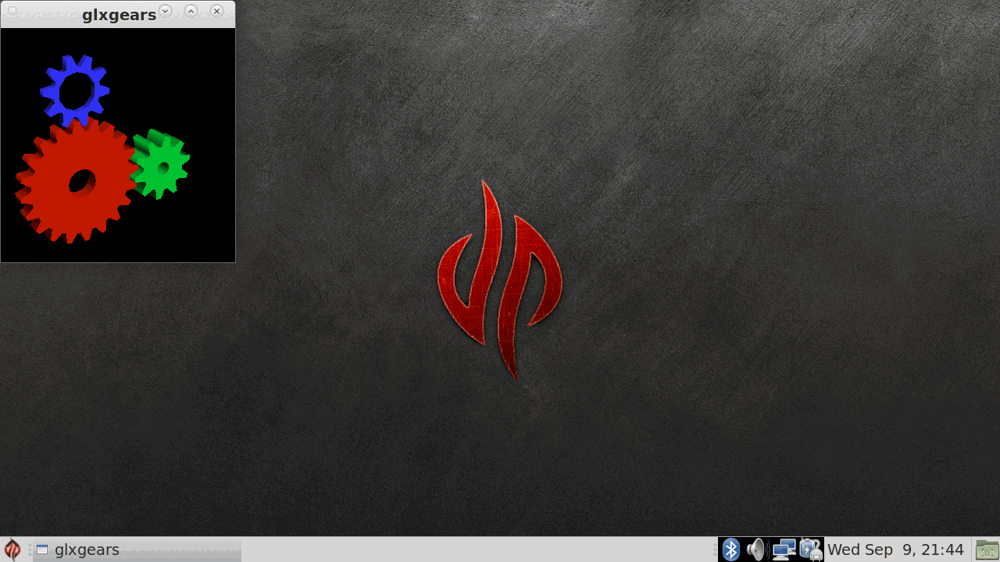

# Desktop GL through gl4es

> **Type: instructions.** Steps to follow.

Tested 2026-09-09 on the running unit. Works.

Fix 4 turns off the X server's GLX extension, so `libGL` from mesa is dead on
this image: `glxinfo` says `couldn't find RGB GLX visual or fbconfig` and
`glxgears` says `couldn't get an RGB, Double-buffered visual`.

**gl4es gets desktop GL back, and gets it back on the SGX rather than in
software.** It is already installed — `libgl-gl4es-pyra` 1.1.7.1 is in the
image, and `/usr/bin/gl4es` is a three-line wrapper that puts gl4es's own
`libGL.so.1` ahead of mesa's on the library path:

    gl4es glxgears
    gl4es <any GL program>

gl4es implements the `glX*` entry points itself and translates GL to GLES, so
it never asks the X server for GLX and fix 4 does not affect it. It picks up
`libEGL.so` and `libGLESv2.so`, which `ldconfig` resolves to the DDK blob in
`/opt/omap5-sgx-ddk-um-linux/lib/` rather than to mesa, so the translation
lands on the hardware.

What it reports:

    OpenGL vendor string: ptitSeb
    OpenGL renderer string: GL4ES wrapper
    OpenGL version string: 2.1 gl4es wrapper 1.1.7
    OpenGL shading language version string: 1.20 via gl4es
    direct rendering: Yes

The `DRI3 1.0` / `present 1.2` lines that `libpvrDRI3WSEGL` prints appear here
too, which is the same proof of hardware window integration as the GLES2 smoke
test in `procedure.md`, section 6.

`glxgears` runs at **~870 FPS** in its default 300x300 window and renders
correctly, gears shaded and depth-tested, on the MATE desktop.

This is better than bookworm, not merely equal to it. Bookworm's GLX here is
software rendered; gl4es is not.

### Per-application, not system-wide

Leave it as the wrapper. Putting `/usr/lib/arm-linux-gnueabihf/gl4es` into
`ld.so.conf` would shadow mesa's `libGL` for every process on the system, and
GL 2.1 is not what every caller expects — GTK4 currently falls back to the
cairo renderer, which works, and would instead start trying a GL path that may
or may not hold up. The upstream package ships a wrapper rather than replacing
`libGL` for exactly this reason. Wrap the programs that need GL:

    Exec=gl4es /usr/games/something          # in a .desktop file

### The one real limitation: fbconfig matching

Asking for a framebuffer config that does not exactly match one the driver
offers fails, where the GLX spec says the size attributes are minimums. gl4es
publishes 12 fbconfigs, all `RGB 888` or `RGBA 8888`, buffer size 16, depth 24,
stencil 8. Ask for `alpha=0` or `depth=16` and you get no config at all rather
than the next one up.

This bites glmark2, which will not start until it is told exactly what exists:

    gl4es glmark2 --visual-config "red=8:green=8:blue=8:alpha=8:buffer=16:depth=24:stencil=8"

**This is not a gl4es defect.** `glmark2-es2`, which goes straight to the DDK's
EGL with gl4es nowhere in the picture, refuses the same loose configs and needs
the same exact one. The strictness is in the blob.

### glmark2 results, and why ten scenes fail

Full run under gl4es, 800x600, score **246**. The scenes that run, run at
hardware speeds:

| Scene | FPS |
| --- | --- |
| pulsar | 597 |
| texture (nearest / linear) | 431 / 427 |
| build (vbo) | 413 |
| bump (height) | 407 |
| shading (blinn-phong / gouraud) | 332 / 323 |
| ideas | 203 |
| bump (high-poly) | 172 |
| jellyfish | 148 |
| desktop (shadow) | 133 |
| buffer (all three) | 86 – 106 |
| shadow | 87 |
| desktop (blur) | 70 |
| terrain | 3 |
| refract | 1 |

`terrain` and `refract` are the two heaviest scenes in the suite and are simply
too much for an SGX 544; that is a hardware result, not a translation problem.

Ten scenes — `conditionals`, `function`, `loop`, `effect2d`, `shading=phong` —
fail to start with:

    ERROR: 0:31: Syntax error, 'HIGHP_OR_DEFAULT' macro redefinition

**This is a glmark2 bug and gl4es is not involved.** glmark2 assembles these
shaders by substitution and ends up emitting its precision preamble twice in a
single shader, once at the top and once again inside `main()`. Desktop GL
drivers tolerate an identical redefinition; GLSL ES forbids redefining a macro
at all, and the SGX compiler enforces that. Confirmed by dumping the converted
source with `LIBGL_DBGSHADERCONV=1` — gl4es's output is correct GLSL ES 100 with
the `#if defined(GL_ES)` guards intact — and then by running the same scenes
through `glmark2-es2`, native GLES2 with no gl4es at all, which fails with the
identical error at the same macros.

So the score understates gl4es. Do not read those ten failures as translation
limits.

`LIBGL_SHADERNOGLES=1`, `LIBGL_NOHIGHP=1` and `LIBGL_NOERROR=1` were each tried
against the failing scenes and none of them help, which is consistent with the
fault being in glmark2's generated source rather than in the conversion.

### Reproducing this

`mesa-utils`, `glmark2-x11` and `glmark2-es2-x11` were installed from the
trixie archive for these tests and are not in the base image.

    sudo apt-get install mesa-utils glmark2-x11 glmark2-es2-x11
    DISPLAY=:0 gl4es glxinfo -B
    DISPLAY=:0 gl4es glxgears

`LIBGL_NOBANNER=1` silences gl4es's forty-line startup report;
`LIBGL_DEBUG=1` expands it.

### The other half: programs that link GLES2 directly

gl4es is for programs that want desktop GL. A program that links the archive's
`libGLESv2` instead — which is every Qt5 toolkit program — gets glvnd's
dispatcher rather than the blob, and draws nothing at all, with no error.
`docs/qt-gles.md` has the diagnosis and the one-symlink cure.

---

