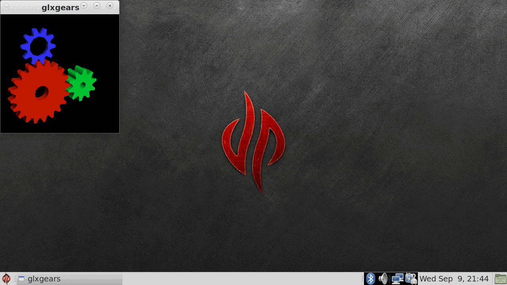

# Desktop GL through gl4es

> **Type: instructions.** Steps to follow.

Tested 2026-09-09 on the running unit. Works.

Fix 4 turns off the X server's GLX extension, so `libGL` from mesa is dead on
this image: `glxinfo` says `couldn't find RGB GLX visual or fbconfig` and
`glxgears` says `couldn't get an RGB, Double-buffered visual`.

**gl4es gets desktop GL back, and gets it back on the SGX rather than in
software.** It is already installed — `libgl-gl4es-pyra` 1.1.7.1 is in the
image, and `/usr/bin/gl4es` is a three-line wrapper that puts gl4es's own
`libGL.so.1` ahead of mesa's on the library path:

    gl4es glxgears
    gl4es <any GL program>

gl4es implements the `glX*` entry points itself and translates GL to GLES, so
it never asks the X server for GLX and fix 4 does not affect it. It picks up
`libEGL.so` and `libGLESv2.so`, which `ldconfig` resolves to the DDK blob in
`/opt/omap5-sgx-ddk-um-linux/lib/` rather than to mesa, so the translation
lands on the hardware.

What it reports:

    OpenGL vendor string: ptitSeb
    OpenGL renderer string: GL4ES wrapper
    OpenGL version string: 2.1 gl4es wrapper 1.1.7
    OpenGL shading language version string: 1.20 via gl4es
    direct rendering: Yes

The `DRI3 1.0` / `present 1.2` lines that `libpvrDRI3WSEGL` prints appear here
too, which is the same proof of hardware window integration as the GLES2 smoke
test in `procedure.md`, section 6.

`glxgears` runs at **~870 FPS** in its default 300x300 window and renders
correctly, gears shaded and depth-tested, on the MATE desktop.

This is better than bookworm, not merely equal to it. Bookworm's GLX here is
software rendered; gl4es is not.

### Per-application, not system-wide

Leave it as the wrapper. Putting `/usr/lib/arm-linux-gnueabihf/gl4es` into
`ld.so.conf` would shadow mesa's `libGL` for every process on the system, and
GL 2.1 is not what every caller expects, and GTK4 would start trying a GL path
through it. (GTK4's own GL renderer already fails on this card: zenity aborts
in it unless `GSK_RENDERER=cairo` is set, `dbp.md` "zenity crashes".) The upstream package ships a wrapper rather than replacing
`libGL` for exactly this reason. Wrap the programs that need GL:

    Exec=gl4es /usr/games/something          # in a .desktop file

The wrapper appends gl4es's directory to `LD_LIBRARY_PATH`. A launcher that
sets `LD_LIBRARY_PATH` to a bundled `lib/` holding its own `libGL.so.1` still
gets its own.

### Programs that need GLX, and what to do about them

A program that links `libGL.so.1` and is started without the wrapper gets
glvnd's `libGL`. glvnd asks the X server for GLX, and fix 4 has turned GLX
off, so there is no window at all. On bookworm the same program ran in
software, slowly. Two kinds of program do this:

- **A DBP from a developer who runs gl4es system-wide.** ptitSeb replaces
  mesa's `libGL` with gl4es on their own Pyra and so forgets the wrapper
  (https://pyra-handheld.com/boards/posts/1703338/: DuckStation build 01
  gave a black screen until it was repacked with `gl4es`).
- **A "mesa-only" program,** one whose author found that it ran with mesa
  and not with gl4es: Ice Field Frenzy
  (https://pyra-handheld.com/boards/posts/1715635/), ft2-clone run in
  mesa mode to dodge audio trouble
  (https://pyra-handheld.com/boards/posts/1704299/).

What it looks like, on the card (r5 release image, 2026-11-21):

| Program | Prints |
| --- | --- |
| SDL2 program (a test program, `SDL_CreateWindow` with `SDL_WINDOW_OPENGL`) | `SDL_CreateWindow: GLX is not supported` |
| SDL 1.2 program (Ice Field Frenzy 1.0.0.2, DBP from the repo) | `Unable to open graphics mode!` (its own message; SDL's error is `Couldn't find matching GLX visual`) |
| plain GLX (`glxinfo`, `glxgears`) | the messages at the top of this page |

**The fix is the wrapper.** For a DBP, start its launcher from a terminal with
the wrapper in front:

    gl4es /usr/local/games/<Exec>

`dbp-run` passes the environment through to the program (checked with Ice
Field Frenzy's launcher, 2026-11-21). `LD_LIBRARY_PATH=/usr/lib/arm-linux-gnueabihf/gl4es`
does the same as the wrapper (checked with the SDL2 test program). The SDL2 test
program then reported `GL_RENDERER: GL4ES wrapper`.

**A "mesa-only" program may only be asking for something gl4es doesn't
have.** Ice Field Frenzy fails under the wrapper too, with the same message.
It asks SDL for a 32-bit depth buffer (`SDL_GL_DEPTH_SIZE` 32), and every
gl4es config has depth 24 (next section). Mesa's software GLX presumably
offered a deeper one (not checked). Clamp the request with a small preload
library. gcc is on the image:

    mkdir -p ~/.local/lib
    cat > /tmp/sdl-depth24.c <<'EOF'
    #define _GNU_SOURCE
    #include <dlfcn.h>
    /* SDL_GL_DEPTH_SIZE is 6 in SDL 1.2. gl4es offers depth 24 only. */
    int SDL_GL_SetAttribute(int a, int v) {
      int (*real)(int, int) = dlsym(RTLD_NEXT, "SDL_GL_SetAttribute");
      if (a == 6 && v > 24) v = 24;
      return real(a, v);
    }
    EOF
    gcc -shared -fPIC -O1 -o ~/.local/lib/sdl-depth24.so /tmp/sdl-depth24.c -ldl
    LD_PRELOAD=~/.local/lib/sdl-depth24.so gl4es /usr/local/games/runicefieldfrenzy.sh

With that, Ice Field Frenzy opens fullscreen at 1280x720 and draws its title
screen on the SGX (checked 2026-11-21, through its DBP launcher).
`SDL_GL_DEPTH_SIZE` is 6 in SDL2 too, so the same library should serve an SDL2
program (not tried). To find what a program asks for, log its
`SDL_GL_SetAttribute` calls the same way.

The forum's ft2-clone test build was not tried. The repository now has
ft2-clone 2.26 (2026), which draws with GLES2 on the SGX directly and needs
neither gl4es nor GLX. It plays clean on kernel r4, and so do Farox's
gl4es demos that warned of audio noise ([dbp.md](dbp.md), "Sound-heavy DBPs").
The old trouble predates the AESS fixes.

What does not help:

- `SDL_VIDEO_X11_FORCE_EGL=1`. SDL2 then opens desktop GL through EGL, but
  `libEGL.so.1` is the SGX blob, which has no desktop GL:
  `SDL_CreateWindow: Could not create GLES window surface`.
- gl4es in `ld.so.conf`, for the reasons above.

### Fullscreen crashes under gl4es that a window doesn't have

jedi23's Fade to Black port (F2BGL, https://pyra-handheld.com/boards/posts/1714399/)
crashed under gl4es in fullscreen, "mostly" when gameplay started, with
`ERROR: I/O error on seeking to offset #####!`. It never crashed in a window
or under mesa. That is very likely fix 21's descriptor double-close, but it
can't be shown on this card.

What fits: f2bgl (upstream source, commit `0b84f41`) creates its window,
sets the swap interval and only then opens its data files. It handles `SDL_WINDOWEVENT_RESIZED` by resizing. When
the window changes size, the SGX window system rebuilds its buffers, and the
stock library then closes descriptor numbers it no longer owns. A test program
in f2bgl's order (open eight files after the swap interval, then resize the
window) lost one data file in 3 of 3 runs with the stock library: the file's
descriptor closed from `libpvrDRI3WSEGL.so+0x154d` and its next `fseek`
returned -1. That is the call behind f2bgl's message. With fix 21's library it
lost none in 3 of 3 runs (2026-11-21). Mesa doesn't go through that library.
The guess is that on jedi23's desktop the window manager resized the window
after it went fullscreen, and a window that keeps its size never triggers it.

Why it can't be shown here: the game data is commercial, the DBP needs
`libfluidsynth.so.1` (trixie has `.so.3`), and on this card's MATE a
`SDL_WINDOW_FULLSCREEN_DESKTOP` window already has its full size when created
and isn't resized later, so the trigger doesn't happen here at all. jedi23 was
on buster or bullseye. Bullseye's library has the same bug (fix 21), and
`pyra-wsegl-fdfix.sh` patches it.

### The one real limitation: fbconfig matching

Asking for a framebuffer config that does not exactly match one the driver
offers fails, where the GLX spec says the size attributes are minimums. gl4es
publishes 12 fbconfigs, all `RGB 888` or `RGBA 8888`, buffer size 16, depth 24,
stencil 8. Ask for `alpha=0` or `depth=16` and you get no config at all rather
than the next one up.

This bites glmark2, which will not start until it is told exactly what exists:

    gl4es glmark2 --visual-config "red=8:green=8:blue=8:alpha=8:buffer=16:depth=24:stencil=8"

**This is not a gl4es defect.** `glmark2-es2`, which goes straight to the DDK's
EGL with gl4es nowhere in the picture, refuses the same loose configs and needs
the same exact one. The strictness is in the blob.

Older gl4es made it worse: with gl4es 1.1.5, DuckStation logged
`EGL_BAD_ATTRIBUTE` and `No EGL configs found` and failed to start, and Stunt
Car Remake logged `No EGL configs found (depth=24, stencil=8)` and segfaulted;
updating gl4es fixed both
(https://pyra-handheld.com/boards/posts/1703368/,
https://pyra-handheld.com/boards/posts/1695646/). Several DBPs say to update
gl4es or get artifacts or crashes. The card has `libgl-gl4es-pyra`
1.1.7.1 (checked 2026-11-21), newer than those reports.

### glmark2 results, and why ten scenes fail

Full run under gl4es, 800x600, score **246**. The scenes that run, run at
hardware speeds:

| Scene | FPS |
| --- | --- |
| pulsar | 597 |
| texture (nearest / linear) | 431 / 427 |
| build (vbo) | 413 |
| bump (height) | 407 |
| shading (blinn-phong / gouraud) | 332 / 323 |
| ideas | 203 |
| bump (high-poly) | 172 |
| jellyfish | 148 |
| desktop (shadow) | 133 |
| buffer (all three) | 86 – 106 |
| shadow | 87 |
| desktop (blur) | 70 |
| terrain | 3 |
| refract | 1 |

`terrain` and `refract` are the two heaviest scenes in the suite and are simply
too much for an SGX 544; that is a hardware result, not a translation problem.

Ten scenes — `conditionals`, `function`, `loop`, `effect2d`, `shading=phong` —
fail to start with:

    ERROR: 0:31: Syntax error, 'HIGHP_OR_DEFAULT' macro redefinition

**This is a glmark2 bug and gl4es is not involved.** glmark2 assembles these
shaders by substitution and ends up emitting its precision preamble twice in a
single shader, once at the top and once again inside `main()`. Desktop GL
drivers tolerate an identical redefinition; GLSL ES forbids redefining a macro
at all, and the SGX compiler enforces that. Confirmed by dumping the converted
source with `LIBGL_DBGSHADERCONV=1` — gl4es's output is correct GLSL ES 100 with
the `#if defined(GL_ES)` guards intact — and then by running the same scenes
through `glmark2-es2`, native GLES2 with no gl4es at all, which fails with the
identical error at the same macros.

So the score understates gl4es. Do not read those ten failures as translation
limits.

`LIBGL_SHADERNOGLES=1`, `LIBGL_NOHIGHP=1` and `LIBGL_NOERROR=1` were each tried
against the failing scenes and none of them help, which is consistent with the
fault being in glmark2's generated source rather than in the conversion.

### Reproducing this

`mesa-utils`, `glmark2-x11` and `glmark2-es2-x11` were installed from the
trixie archive for these tests and are not in the base image.

    sudo apt-get install mesa-utils glmark2-x11 glmark2-es2-x11
    DISPLAY=:0 gl4es glxinfo -B
    DISPLAY=:0 gl4es glxgears

`LIBGL_NOBANNER=1` silences gl4es's forty-line startup report;
`LIBGL_DEBUG=1` expands it.

### The other half: programs that link GLES2 directly

gl4es is for programs that want desktop GL. A program that links the archive's
`libGLESv2` instead — which is every Qt5 toolkit program — gets glvnd's
dispatcher rather than the blob, and draws nothing at all, with no error.
`docs/qt-gles.md` has the diagnosis and the one-symlink cure.

---

