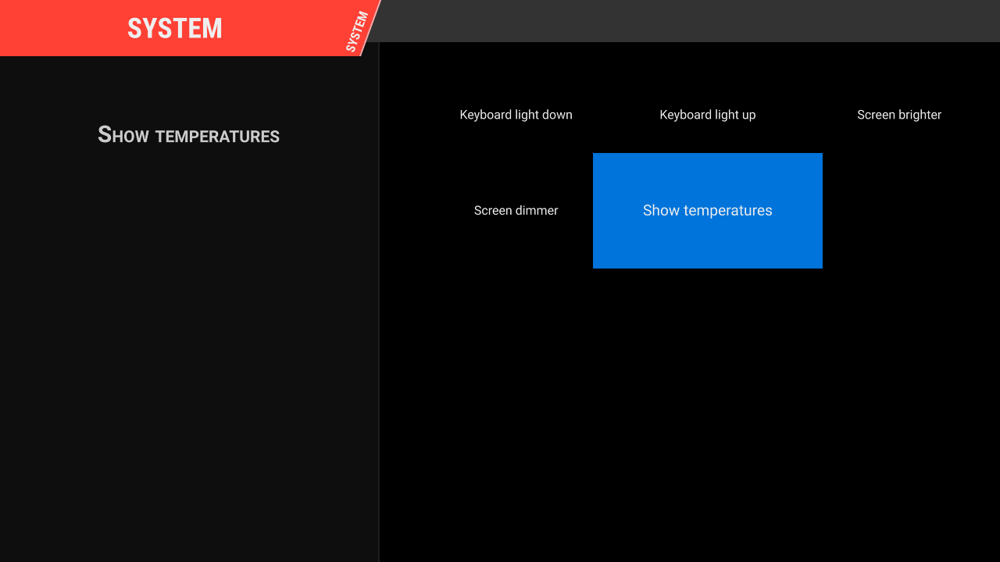

# Pegasus on the Pyra, and custom menus for the hardware

> **Type: log.** A dated record of what was done and found: history, not instructions.

> **Superseded, 2026-09-19.** Pegasus is dropped as the launcher: it costs 9-30%
> of a core sitting on a static menu, where a plain `qmlscene` control costs
> 0.0% (measured, `experiments/pegasus-idle/RESULT.md`). A separate launcher,
> `pyra-gamemode`, is being written instead. Nothing below is a plan any more.
> The page stays for the scoping and the measurements, and because `pyra-gles`
> (`docs/qt-gles.md`) is needed by any Qt program, not only Pegasus.

Scoped 2026-09-18 against the running unit and against Pegasus at commit
`83fd27f` (2026-09-15). Nothing here is installed on the device yet. The one
thing that could have made the whole idea impossible has been tested and does
not: see `docs/qt-gles.md`.

Pegasus Frontend is a QML launcher — it lists games and runs them, and does not
emulate anything itself. It is ~20k lines of C++ plus QML, GPLv3, and it is
actively developed rather than a dormant project. The reason to want it here is
that it is a controller-driven fullscreen shell for a handheld, and the reason
it is worth writing down before starting is that **the part you actually want —
a brightness, thermals and battery menu — is the part its theme API cannot
do.**

---

## What is already established

| Question | Answer | How |
| --- | --- | --- |
| Does Qt Quick run on the SGX at all? | Yes, after one symlink | `docs/qt-gles.md` |
| Fast enough? | 117 fps on a busy 1280x720 scene, 171 fps on a light one | `QSG_RENDER_TIMING` frame counts |
| Are the build dependencies in trixie? | All of them | `apt-cache policy` on the device |
| Qt Gamepad? | **Not in trixie.** `qtgamepad5-dev` has no candidate | ditto |
| So gamepad support? | SDL2, which upstream prefers anyway. `libsdl2 2.32.4` is installed | ditto |
| Will it see the controls? | `pyraInput Gamepad` is `js2`, plus `pyra-game-buttons` and the built-in keyboard | `/proc/bus/input/devices` |
| Battery in the theme API? | Percent and charging state work; **seconds remaining never will** | `api.device` uses SDL power, which reads `capacity` and `status`; the `bq27421-0` gauge exposes no `time_to_empty_now` |
| Video previews in themes? | Software decode only — there is no `/dev/video*` on this machine | device |
| Screen | 1280x720, panel rotated | `xrandr` |

## The thing that costs money: themes cannot touch the hardware

The theme QML API is `api.collections`, `api.allGames`, `api.keys`,
`api.memory` and `api.device`. `api.device` is battery and nothing else. There
is no process execution, no file access and no sysfs. Themes are sandboxed by
omission, and that is a deliberate upstream choice.

There is a second constraint that rules out the obvious workaround.
`ProcessLauncher` does not merely start a program: `FrontendLayer::teardown()`
**deletes the whole `QQmlApplicationEngine`** before the game runs and rebuilds
it afterwards. So a "System" collection whose games are shell commands does
work — but every press tears the theme down and reloads it, which on this
hardware is seconds, and there is no way to show a value that changes while you
look at it.

Three routes, then:

**A. Metadata entries, no code.** A collection in `metadata.pegasus.txt` whose
entries are commands: keyboard light on/off, reboot to MATE, run a thermal
probe. Two hours of work, no build, no fork. Correct for one-shot actions,
useless for a slider or a live reading.

**B. Patch the backend.** The extension point is clean and small.
`src/backend/model/device/DeviceInfo.h` is an ordinary `QObject` with
`Q_PROPERTY` declarations and a `QTimer` poll, and it reaches QML through a
single line in `src/backend/model/Api.h`:

    QML_CONST_PROPERTY(model::DeviceInfo, device)

A `PyraDevice` sibling registered the same way puts the backlights, the five
thermal zones, cpufreq and the real fuel-gauge numbers in front of a QML page
in a custom theme. ~250–350 lines of C++ and a header, plus the theme.

**C. A local helper daemon the theme talks to over HTTP.** Rejected without
testing it. QML's `XMLHttpRequest` should reach a loopback port, so it would
probably work without touching Pegasus at all — and it would mean any theme
anyone ever installs can drive that daemon, on a machine where themes are
downloaded QML.
All of B's cost with none of its containment.

**Take B**, and keep A as the escape hatch for anything that genuinely wants to
leave the UI (reboot to the desktop, run a probe script).

## What to expose, and what to refuse

| Item | Read from | Written how |
| --- | --- | --- |
| Screen brightness | `/sys/class/backlight/backlight` — note `max_brightness` is **15**, so sixteen steps and no more | logind `SetBrightness` on D-Bus |
| Keyboard backlight | `/sys/class/backlight/keyboard-backlight`, max 8 | the same call with the device named — `pyra-idle-dim` already takes the device as a parameter |
| Battery | `bq27421-0`: `capacity`, `status`, `current_now`, `voltage_now`, `temp` | read-only |
| Charger | `bq24297`: `online`, `status`, and the input current limit fix 8 installs | read-only in the UI |
| Temperatures | the five zones: `cpu_thermal`, `gpu_thermal`, `core_thermal`, and the two gauge dies | read-only |
| CPU | `scaling_cur_freq`, `scaling_max_freq`, governor | **read-only** |
| LEDs | `/sys/class/leds`, eighteen of them | optional, and only as named presets |

Three rules that matter more than the feature list:

1. **No generic "write this path" invokable.** Themes are third-party QML
   running in the same engine as the API object. Whatever `PyraDevice` exposes,
   every theme the user ever installs can call. Enumerated actions, clamped
   ranges, no path parameter.
2. **Backlight goes through logind, not root.** `pyra-idle-dim`, now in the
   `pyra-backlight` package, already proves the session owner can call
   `org.freedesktop.login1`'s `SetBrightness` for its own seat, which is why it needs no privilege and no setuid helper —
   it even takes the device name as a parameter, so the keyboard light is the
   same call. Reuse it, with `QT += dbus`. The one condition is that the caller
   has to be in the active graphical session, which a launcher is and an ssh
   shell is not.
3. **The thermal page is a display, not a control.** `pyra-thermal.service` now
   decides a frequency cap every few seconds and, since fix 6, can actually
   apply it. A slider writing `scaling_max_freq` from the launcher would be
   overwritten within one poll and would fight the one piece of thermal
   protection this machine has. If profiles are wanted later, they go through
   the daemon's configuration, not around it.

## Building it: cross, on the PC

Native building on the device was considered and dropped: 20k lines of C++ and
Qt on two Cortex-A15s means a long build at exactly the moment the thermal
daemon starts capping frequency, so it is both slow and self-slowing. The
existing pattern in `pc/pyra-crossbuild.sh` — a throwaway Debian container,
a real cross-compile, nothing installed on the host — applies directly.

**Debian's Qt 5 cross-builds without qemu**, which is the part worth knowing
before starting. Asking a trixie container for `qtbase5-dev:armhf` resolves the
libraries as armhf and the build tools as **amd64**:

    Conf qt5-qmake-bin           (amd64)
    Conf qtbase5-dev-tools       (amd64)
    Conf qtdeclarative5-dev-tools(amd64)
    Conf qtbase5-dev:armhf       (armhf)
    Conf qtdeclarative5-dev:armhf(armhf)

so `moc`, `rcc` and `qmlcachegen` run at host speed while everything they
generate is compiled for the device. No binfmt registration is needed — and
none exists on this workstation, which would otherwise have been the first
thing to trip over.

Packages: `crossbuild-essential-armhf cmake ninja-build pkg-config
qtbase5-dev:armhf qtdeclarative5-dev:armhf qtmultimedia5-dev:armhf
libqt5svg5-dev:armhf libsdl2-dev:armhf qttools5-dev-tools
libqt5sql5-sqlite:armhf`.

The toolchain file is four lines of substance, and one of them is the one that
matters:

    set(CMAKE_SYSTEM_NAME Linux)
    set(CMAKE_SYSTEM_PROCESSOR arm)
    set(CMAKE_C_COMPILER   arm-linux-gnueabihf-gcc)
    set(CMAKE_CXX_COMPILER arm-linux-gnueabihf-g++)
    set(CMAKE_LIBRARY_ARCHITECTURE arm-linux-gnueabihf)

`CMAKE_LIBRARY_ARCHITECTURE` is what lets `find_package(Qt5)` find
`/usr/lib/arm-linux-gnueabihf/cmake/Qt5`. A toolchain that instead sets
`CMAKE_FIND_ROOT_PATH_MODE_PACKAGE ONLY` with the multiarch directory as the
root fails at the first `find_package(Qt5)`, in the vendored
`SortFilterProxyModel`, which is a confusing place to meet the error.

Configure options: `-DPEGASUS_USE_SDL2_GAMEPAD=ON` (mandatory here — there is
no Qt Gamepad to fall back to), `-DPEGASUS_USE_SDL2_POWER=ON` (this is what
makes `api.device.batteryPercent` real), and `-DPEGASUS_ENABLE_LTO=OFF` for the
first build because it is slow and obscures errors.

Two repository details: clone `--recurse-submodules` (the theme, the
translations and `SortFilterProxyModel` are submodules), and pin a commit
rather than a tag — upstream's `weekly_*` tags stop at `2024w38` while master
is current.

### This has been done, once

Commit `83fd27f` cross-builds clean in a `debian:trixie` container with the
above: 394 ninja targets including the test suite, no patches, no warnings
worth repeating, and a 3.7 MB armhf binary out the other end.

    src/app/pegasus-fe: ELF 32-bit LSB pie executable, ARM, EABI5 version 1,
    dynamically linked, interpreter /lib/ld-linux-armhf.so.3

The whole container run, from `apt-get` to binary, is minutes on a desktop. A
native build on the device would be the better part of an hour by comparison,
and every minute of it at whatever frequency the thermal daemon had decided on
by then — which is the argument for doing it this way rather than a
measurement of it.

Two things cost a round trip each and are worth knowing before the first try:
`qttools5-dev:armhf` is needed as well as `qttools5-dev-tools`, because
`Qt5Config.cmake` pulls in `Qt5LinguistTools` and that config file comes from
the armhf development package; and a toolchain using
`CMAKE_FIND_ROOT_PATH_MODE_PACKAGE ONLY` fails to find Qt 5 at all, in the
vendored `SortFilterProxyModel`, which is a misleading place to be told about
it.

### And it runs

It was pushed to the device and started fullscreen on the real panel under
`pyra-gles`, with a five-entry "System" collection whose games are shell
commands — route A from above, built as a test rather than as a plan:

| | |
| --- | --- |
| Renderer | `PowerVR SGX 544MP`, `OpenGL ES 2.0 build 1.14@3699939`, threaded render loop |
| Cold start to a steady frame | 2.7 s, of which 1.2 s is the game scan |
| Gamepad | `pyraInput Gamepad` picked up by SDL2 with no configuration at all |
| Resident memory | 64 MB |
| Launch round trip, no-op command | ~1.7 s from keypress to the theme being back |
| Sitting on the home screen | 29.5% of one core as shipped, 9.1% tuned, against 6% of both cores for the desktop alone |

**The idle cost is the finding to take seriously.** The machine at the MATE
desktop with nothing running is 6% busy across both cores. Pegasus sitting on
its home screen with nothing happening burns 29.5% of one core.

That is now measured rather than guessed, and it is mostly fixable — a theme
that does not animate and one environment variable take it to 9.1%. The whole
comparison, including the control that rules out Qt and the driver, is in
`experiments/pegasus-idle/RESULT.md`; the short version is below.

That 1.7 s is the number that decides route A. It is the cost of
`FrontendLayer::teardown()` and the rebuild that follows, for a command that
does nothing at all, and it is what every press of a "brightness up" entry
would cost. Fine for "reboot to the desktop". Not a settings menu.

The base image needs four more runtime packages before the binary will start:
`libqt5sql5t64`, `libqt5sql5-sqlite`, `qml-module-qtquick-layouts` and
`qml-module-qtgraphicaleffects` (plus `qml-module-qtmultimedia` for themes that
want it). The bundled Grid theme also logs a missing `system.svg` for a
collection with no logo, which is cosmetic.

### What the idle cost is made of, and how to get most of it back

Measured with the frontend's own CPU time, 40-second windows, the machine
cooled below 64°C before each condition so the frequency ceiling is the same:

| what is running | render loop | frontend |
| --- | --- | --- |
| Grid theme, as shipped | threaded (Qt's default) | **29.5%** of one core |
| A theme with no animation at all | threaded | 21.0% |
| Grid theme | `QSG_RENDER_LOOP=basic` | 18.2% |
| No animation **and** `QSG_RENDER_LOOP=basic` | basic | **9.1%** |
| *control:* `qmlscene`, static scene, no Pegasus | threaded | 0.0% |

Three things fall out of that.

The animation is worth about a third — real, but not the main cost. A theme
that renders **zero** frames per second still burns 21%.

Most of the rest is a render thread that renders nothing: with the static theme
`QSGRenderThread` accounts for 11.5 of those 21 points while the frame counter
sits at zero. `QSG_RENDER_LOOP=basic` puts rendering back on the GUI thread and
that cost disappears, in both themes, with no visible difference on screen —
the same screenshot, no lag. Treat it as free.

And it is not Qt's fault, which is what the control is for: a bare `qmlscene`
showing a static scene, same GLES stack, same shim, same *threaded* loop, costs
0.0%. Qt Quick at rest on this hardware is free. Something Pegasus does keeps
that thread awake.

What is left after both changes is ~8% on the GUI thread, which is where
`GamepadManagerSDL2` polls SDL every 16 ms on a machine whose gamepad is
soldered on. Raising that interval is a one-line change in the same file the
launch-abort workaround points at, and it is the next measurement rather than a
conclusion.

**So a launcher session is viable**: 9.1% of one core, not the 29.5% it ships
with, for one theme and one environment variable.

### The launch path can abort the frontend

Launching a game sometimes kills Pegasus outright:

    [i] Executing command: [`/tmp/sysact.sh`,`temps`]
    [i] Process 21306 started
    Assertion 'close_nointr(fd) != -EBADF' failed at src/basic/fd-util.c:75,
    function safe_close(). Aborting.

That assertion is libsystemd's, and it fires on a double `close()`. Pegasus is
not calling it: `ProcessLauncher` tears the frontend down and, on the way,
`GamepadManagerSDL2::stop()` calls `SDL_QuitSubSystem` for both the game
controller and the joystick subsystems, which takes SDL's udev monitor down
with it. SDL2 links `libsystemd` for that monitor. Something in that teardown
closes an already-closed descriptor, and libsystemd's response to a double
close is to abort the process.

It is a race, and the rate is not fixed. On an idle machine it aborted **once
in four** launches. While the machine was loaded and the thermal daemon had the
ceiling down at 750 MHz–1 GHz, it aborted on **four of four**. When it fires,
either the process dies outright or it survives as a spinning orphan at 20–30%
of a core with a stale window and a QML engine that never comes back — both
observed.

`SDL_JOYSTICK_DISABLE_UDEV=1` avoids it: **eight launches across two sessions,
no aborts, the engine rebuilt every time**, and SDL still found the gamepad (it falls back to
scanning `/dev/input`, which is enough for a controller that is soldered to the
machine — hotplug of an external pad through that path is untested).

Treat that variable as required for now, and treat the underlying fault as
worth a report: nothing about it is Pyra-specific beyond the timing, and any
Pegasus-on-Linux install with SDL2 gamepad support is standing on it.

### What has not been done

The menus themselves. Everything above is the frontend running as upstream
ships it.

## Running it on the device

- **In front of it goes `pyra-gles`.** Without the shim Pegasus will start,
  create a real EGL context and draw nothing. See `docs/qt-gles.md`.
- **Session, not replacement.** A session entry that runs
  `pyra-gles /opt/pegasus/pegasus-fe`, with MATE left installed and
  selectable. There is no reason to make this machine one-purpose.
- **Turn off X blanking for that session.** The one unfixed fault on this
  machine is a modeset that can wedge the display, and every DPMS transition is
  a modeset. A fullscreen launcher that blanks on idle is aimed straight at it.
  `pyra-idle-dim` dims the backlight and performs no modeset; that is the right
  idle behaviour here and it already exists.
- **Pick a theme with static art.** No hardware video decode.

## Maintenance, honestly

This is a patch carried against an upstream that commits weekly, and a Pyra
device object is not upstreamable as-is. Keep it as a small series against a
pinned commit, in the shape `patches/` already uses for the kernel, and expect
to rebase it occasionally. The alternative — a fork with merges — costs more
and hides what was changed.

---

## TODO

Ordered. Effort is one person's evenings, not ideal-world estimates.

- [ ] **Decide whether `pyra-gles` becomes fix 13.** Every Qt5 GLES program on
      this image renders nothing until the shim exists, which is the same class
      of silent, total failure the twelve numbered fixes cover. Promoting it means
      `pc/pyra-trixie-prep.sh`, the prep selftest, `procedure.md` and the
      README's first-boot list all change. Leaving it as a helper means
      anyone hitting the bug has to find this document first. — *an open decision.*
- [ ] **Add a `pegasus` target to `pc/pyra-crossbuild.sh`.** The build itself
      is proven (above), so this is packaging it the way the other targets are
      packaged: same container pattern as `ddx`, a pinned commit, the toolchain
      file, and the binary dropped where `pyra-push-helpers.sh` can carry it
      over. — *two or three hours*
- [x] **Get it onto the device and confirm it draws.** Done 2026-09-18: it
      runs fullscreen on the SGX, the bundled theme renders, and a collection
      of shell commands works. The section above has the numbers.
- [x] **Find out what the idle cost really is, and whether a theme fixes it.**
      Done 2026-09-18, and it half fixes it: 29.5% → 21% for a theme that never
      animates, → 9.1% with `QSG_RENDER_LOOP=basic` as well.
      `experiments/pegasus-idle/RESULT.md` has the matrix and the controls.
- [ ] **Try the SDL poll interval.** The ~8% that survives both fixes is
      `GamepadManagerSDL2`'s 16 ms timer, on a machine whose gamepad is
      soldered to it. One line, then measure it the same way. — *an hour*
- [ ] **Deal with the SDL udev abort.** `SDL_JOYSTICK_DISABLE_UDEV=1` is the
      workaround and it held for eight launches; confirm it holds over a longer
      run, find out whether external pads still hotplug under it, and decide
      whether to report the double close to SDL. This is not Pyra-specific.
      — *a few hours, plus a report if you want one*
- [ ] **Map the controls.** SDL2 found `pyraInput Gamepad` by itself, which is
      further than expected; what is unchecked is whether the shoulder buttons
      and the nubs land somewhere sane, and whether an `SDL_GAMECONTROLLERCONFIG`
      entry is worth writing for this device. — *a few hours*
- [ ] **Write `PyraDevice`.** The C++ object, the `Api.h` registration, the
      logind D-Bus calls for both backlights, polled reads for the rest, and
      the three rules above enforced in the class rather than in the theme. —
      *1–2 days*
- [ ] **Write the menu page.** A theme fork or an overlay: brightness, keyboard
      light, battery and charger, temperatures, and the current frequency cap
      shown as a fact rather than a control. — *1 day*
- [ ] **Decide where the patch series lives.** `patches/` is kernel-only today.
      A sibling directory, or a separate repository. — *your call*
- [ ] **Decide about the session.** A `.desktop` session entry running
      `pyra-gles pegasus-fe` with `QSG_RENDER_LOOP=basic` and
      `SDL_JOYSTICK_DISABLE_UDEV=1` set, X blanking off for that session, MATE
      left installed and selectable. — *an hour*

## Measured here, versus assumed

Measured on the device on 2026-09-18: Qt Quick renders on the SGX through the
shim and at what speed; the trixie package availability including the absence
of `qtgamepad5-dev`; the input device list; the backlight ranges; the fuel
gauge's attribute set; the absence of `/dev/video*`. Measured on the
workstation: that Debian resolves an armhf Qt 5 dev environment with amd64 host
tools.

Built on the workstation on 2026-09-18: Pegasus `83fd27f` for armhf, from a
clean container, with the options above.

Run on the device on 2026-09-18: fullscreen on the panel under `pyra-gles`,
with a System collection of shell commands. Measured there: the renderer
strings, the 2.7 s cold start, the 1.7 s launch round trip, the 64 MB resident
set, SDL2 finding the gamepad unaided, and the libsystemd abort — one in four
launches idle, four in four under load, none in eight with
`SDL_JOYSTICK_DISABLE_UDEV=1`. The idle cost was then measured properly against
controls, twice per condition: `experiments/pegasus-idle/RESULT.md`.

Not trusted, and said so there: battery current. The same desktop-idle
condition read 333 mA cold and 478 mA warm within one session, so at this
resolution the gauge follows die temperature as much as load. Every conclusion
above rests on CPU time instead.

Read from the Pegasus source rather than run: the theme API surface, the engine
teardown on launch, and the shape of the `DeviceInfo` extension point.

Not done at all: the menus, the session integration, and the C++ that the
hardware pages need. Nothing in this repository has been changed to
accommodate Pegasus, and nothing needs to be until those decisions are made.
